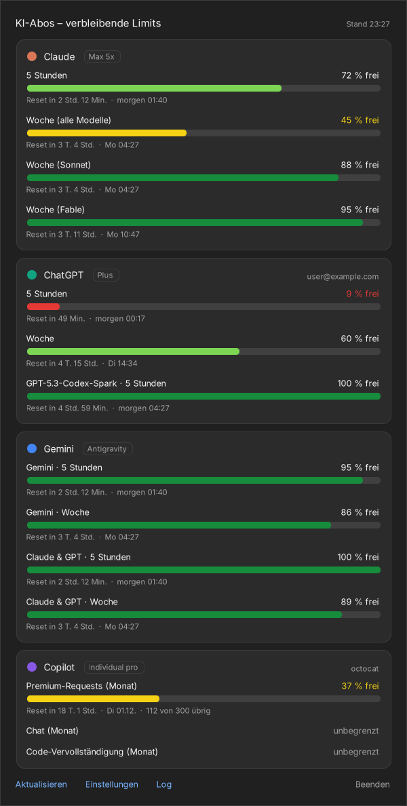

# AiMOnitoR (AMOR) – AI Usage Monitor

**See how much of your AI subscription limits is left, right in the Windows taskbar.**

A tiny Windows tray app that shows two mini bars per AI subscription (short window, usually 5 hours, and weekly window) for **Claude**, **ChatGPT (Codex)**, **Gemini (Antigravity)** and **GitHub Copilot**. Click an icon to see every limit in detail, including when it resets.

<p align="center">
  <br>
  
</p>

- No installation and no dependencies. It builds with the C# compiler that ships with every Windows 10/11 (.NET Framework 4.x).
- It reuses the logins of the official CLIs you already have. There are no API keys, and it stores no passwords of its own.
- It refreshes every minute; Gemini refreshes every 5 minutes because each check starts the Antigravity CLI.
- Bar colours follow a traffic-light scale, and a coloured stripe under the bars identifies the provider.
- Autostart, single instance, dark and light taskbar, high-DPI.

> **Note:** The user interface is currently **German**. Pull requests for other languages are welcome.

## What is shown

| Provider | Left bar | Right bar | Also in the detail view |
|---|---|---|---|
| **Claude** (salmon stripe) | 5-hour limit | weekly limit (all models) | weekly limits per model, extra usage |
| **ChatGPT** (teal stripe) | 5-hour limit | weekly limit | extra limits (e.g. Codex-Spark), credits |
| **Gemini** (blue stripe) | 5-hour limit (Gemini models) | weekly limit (Gemini models) | Claude & GPT limits inside Antigravity |
| **Copilot** (purple stripe) | premium requests (monthly) | only on the Free plan: chat | chat / completions, remaining count |

Bar colour shows the **remaining** share:

| remaining | colour |
|---|---|
| 100–75 % | dark green |
| 75–50 % | light green |
| 50–25 % | yellow |
| 25–10 % | orange |
| 10–1 % | red |
| 0 % | black (whole bar) |

A grey corner on an icon means the provider is not set up. A white corner means the last refresh failed; the detail view says why. When a refresh fails, the last known values stay visible but faded.

## Requirements

- Windows 10 or 11
- .NET Framework 4.x (preinstalled on Windows 10/11)
- For each subscription you want to track, the matching official CLI, signed in once with that subscription:

| Provider | Sign in once with | Credentials the monitor reads |
|---|---|---|
| Claude (Pro/Max/Team) | [Claude Code](https://code.claude.com/docs/en/setup): `irm https://claude.ai/install.ps1 \| iex`, then `claude` and log in | `%USERPROFILE%\.claude\.credentials.json` |
| ChatGPT (Plus/Pro/…) | [Codex CLI](https://github.com/openai/codex): `npm i -g @openai/codex`, then `codex login` → *Sign in with ChatGPT* | `%USERPROFILE%\.codex\auth.json` |
| Gemini (Google AI Pro/Ultra/free) | [Antigravity CLI](https://antigravity.google): `irm https://antigravity.google/cli/install.ps1 \| iex`, then `agy` and sign in with Google (run it in your own folder, not in `System32`) | managed by `agy` itself |
| GitHub Copilot | right-click a tray icon → *GitHub Copilot anmelden…* (GitHub device login), **or** an existing `gh auth login` / Copilot editor plugin login | own login (DPAPI-encrypted), `%LOCALAPPDATA%\github-copilot\apps.json` or `gh auth token` |

Providers you don't use can be switched off in the settings, or simply left unconfigured; they then show a grey corner.

## Install

1. Download the repository (*Code → Download ZIP*) and unpack it somewhere permanent, e.g. `C:\Tools\ai-usage-monitor`.
2. Double-click **`install.bat`**. It builds `AIUsageMonitor.exe`, adds it to Windows autostart and starts it.
   (Use `build.bat` instead if you only want to build and start it, without autostart.)
3. Windows 11 hides new tray icons behind the `^` arrow. Drag the four icons onto the taskbar, or enable them under *Settings → Personalization → Taskbar → Other system tray icons*.

To remove it, run **`uninstall.bat`**. It stops the monitor and removes the autostart entry. Settings live in `%APPDATA%\AIUsageMonitor`.

> If you move the folder later, run `install.bat` again. Windows ties tray icon positions to the program's path.

## Usage

- **Left-click** an icon to open or close the detail view. `Esc` closes it and `F5` refreshes.
- **Right-click** an icon for the menu: refresh, autostart on/off, Copilot login, settings, log, quit.
- Click a **provider name** in the detail view to open that provider's usage page in your browser.

## Settings

Right-click → *Einstellungen (config.json)* opens `%APPDATA%\AIUsageMonitor\config.json`:

```json
{
  "configVersion": 2,
  "refreshMinutes": 1,
  "providers": { "claude": true, "chatgpt": true, "gemini": true, "copilot": true },
  "claudeAllowTokenRefresh": true,
  "codexAllowTokenRefresh": true,
  "copilotToken": ""
}
```

| Key | Meaning |
|---|---|
| `refreshMinutes` | Refresh interval in minutes (minimum 1). Gemini is refreshed at most every 5 minutes. |
| `providers` | Show or hide individual providers. |
| `claudeAllowTokenRefresh` / `codexAllowTokenRefresh` | When the CLI's access token has expired, the monitor renews it and writes it back to the CLI's credential file, as the CLI itself would. Set to `false` to never touch those files; you then have to start `claude` / `codex` now and then. |
| `copilotToken` | Filled automatically by *GitHub Copilot anmelden…*, stored encrypted with Windows DPAPI. |

Changes are picked up on the next refresh.

## How it works

| Provider | Data source |
|---|---|
| Claude | `GET https://api.anthropic.com/api/oauth/usage` with the Claude Code OAuth token (the same numbers as *claude.ai → Settings → Usage*) |
| ChatGPT | `GET https://chatgpt.com/backend-api/wham/usage` with the Codex CLI ChatGPT token |
| Gemini | `agy -p /usage --output-format json`, the Antigravity CLI's own usage report (no prompt is sent and no quota is used) |
| Copilot | `GET https://api.github.com/copilot_internal/user` |

Since 18 June 2026, Google no longer serves the old Gemini CLI for personal accounts (free, AI Pro and AI Ultra). Gemini limits therefore come from Antigravity.

On HTTP 429 (too many requests), only the affected provider is paused for 2, 4, 8 and up to 15 minutes. If the Antigravity CLI fails (for example because you're not signed in), Gemini is paused for 15 minutes. Each Antigravity check runs in a Windows job object, so no `agy` processes are left behind.

### Privacy and security

- Credentials are read locally and are only ever sent to the provider they belong to (Anthropic, OpenAI, Google or GitHub). There is no telemetry and no other server.
- Tokens are never written to the log (`log.txt` next to the EXE).
- The source is a few hundred lines of plain C#. Read it before you run it, then build it yourself.

> ⚠️ **Disclaimer:** This is an unofficial tool and is not affiliated with Anthropic, OpenAI, Google or GitHub. It uses **undocumented endpoints** that can change or break at any time. All trademarks belong to their respective owners.

## Building manually and tests

```bat
build.bat            :: builds AIUsageMonitor.exe and starts it
build.bat nostart    :: builds only
```

The tests in `tests/Test.cs` check how each provider's responses are parsed, using sample data, and they render preview images. They run with Mono, for example on Linux:

```bash
mcs -langversion:5 -target:exe -out:test.exe -main:AIUsageMonitor.TestMain \
    -r:System.Web.Extensions -r:System.Windows.Forms -r:System.Drawing -r:System.Security \
    src/*.cs tests/Test.cs
xvfb-run -a mono test.exe out/
```

The code deliberately sticks to **C# 5**, so that it compiles with the `csc.exe` built into Windows.

| File | Contents |
|---|---|
| `src/Providers.cs` | Claude, ChatGPT and Copilot: fetching, token refresh and response parsing |
| `src/Antigravity.cs` | Gemini via the Antigravity CLI (job object, report parsing) |
| `src/UI.cs` | tray icon rendering, detail view, Copilot login, app logic |
| `src/Tray.cs` | own tray icons with a stable GUID per provider |
| `src/Util.cs` | HTTP, JSON, config, log, formatting |

## Credits

The undocumented usage endpoints and response formats were figured out by looking at the excellent macOS menu bar app [CodexBar](https://github.com/steipete/CodexBar) by Peter Steinberger.

## Deutsch (Kurzfassung)

Ein kleines Tray-Programm für Windows. Es zeigt für Claude, ChatGPT, Gemini und GitHub Copilot, wie viel vom 5-Stunden- und Wochenlimit noch frei ist. Die Balkenfarben folgen einer Ampel von dunkelgrün bis schwarz, und ein farbiger Streifen unter den Balken zeigt den Anbieter. Ein Klick öffnet die Details mit den Reset-Zeiten.

So richtest du es ein:

1. Repo herunterladen.
2. `install.bat` doppelklicken.
3. Pro Abo einmal im offiziellen Tool anmelden: `claude`, `codex login`, `agy` und für Copilot Rechtsklick → *GitHub Copilot anmelden…*

Die Oberfläche ist auf Deutsch.

## License

[MIT](LICENSE)
